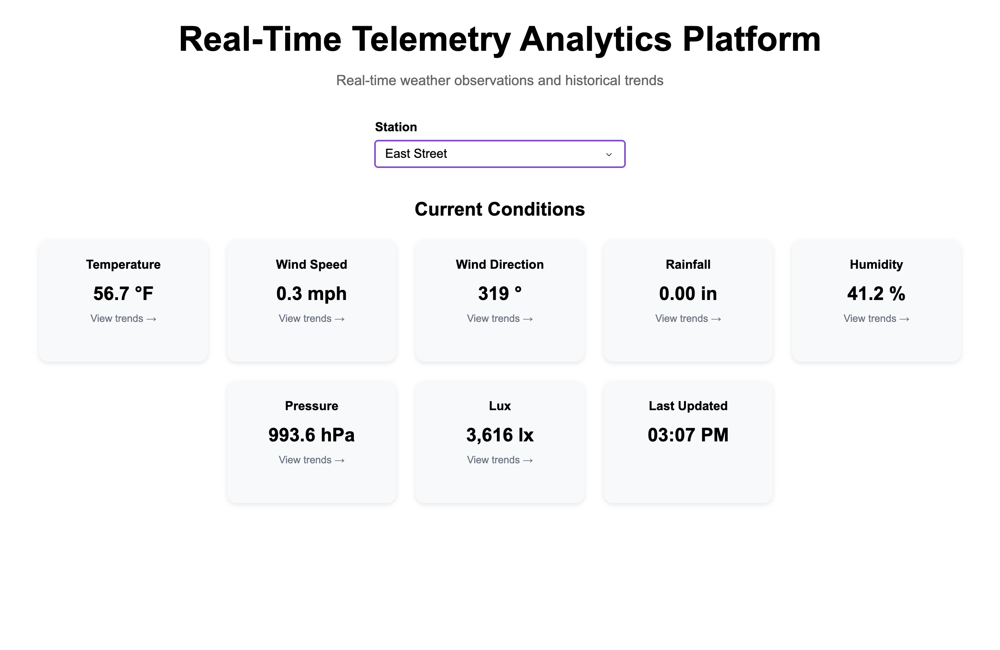
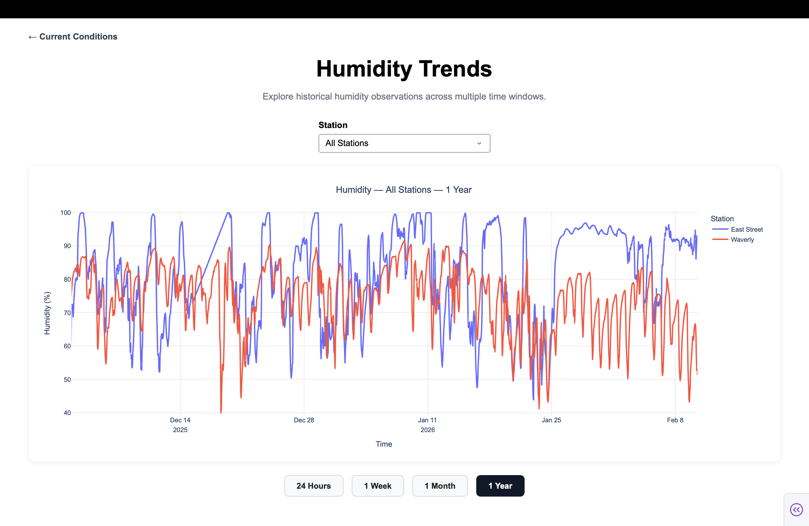
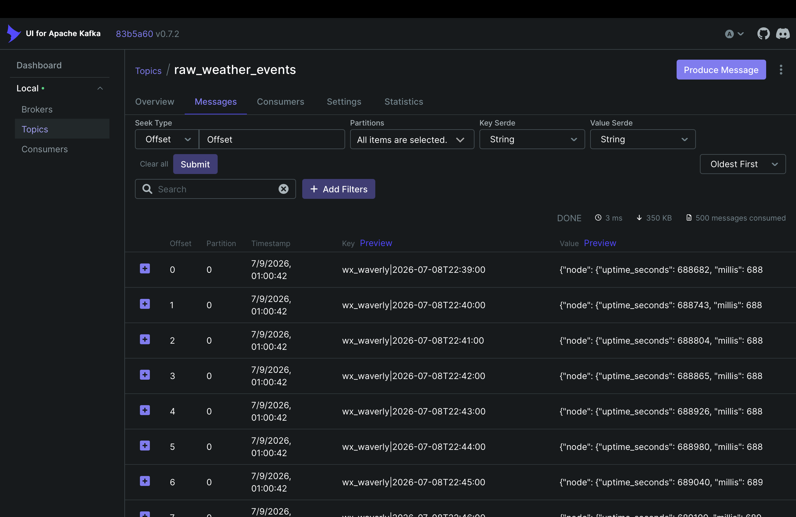

# Real-Time Weather Analytics Platform

[](https://github.com/alluriv2/real-time-weather-analytics-platform/actions/workflows/ci.yml)


> An end-to-end, event-driven platform for weather-station telemetry: Kafka ingestion, idempotent PostgreSQL storage, time-window aggregates, a REST API and a live dashboard, deployed to AWS Lightsail with automated CI/CD and monitoring.

**Live dashboard:** [weather.alluriv.dev](https://weather.alluriv.dev)



## At a glance

| | |
|---|---|
| **What it does** | Collects historical and live weather-station telemetry, stores it in PostgreSQL, builds day, week, month and year aggregates, and serves current conditions and historical trends through FastAPI and a Plotly Dash dashboard |
| **Architecture** | Nine core services on one AWS Lightsail instance with Docker Compose: backfill, producer, Kafka, consumer, PostgreSQL, aggregator, API, dashboard and Nginx. Prometheus, Grafana and Kafka UI are optional |
| **Data flow** | Backfill and live producer → Kafka → consumer → PostgreSQL → aggregator and API → dashboard. Historical and live data take the same path, so they share one set of validation and storage rules |
| **Delivery guarantees** | At-least-once delivery with idempotent writes. The consumer reads a batch, commits one PostgreSQL transaction, then commits the Kafka offsets, so a failed batch replays and a duplicate batch changes nothing. Batches are 1,000 records |
| **Recovery** | On startup the platform compares source, producer, consumer and database timestamps and republishes only the window that is missing. Ingestion progress is stored in PostgreSQL |
| **Data freshness** | A consumer watchdog restarts a consumer that loses its Kafka group, and `/health/data` returns 503 when the newest write is stale, so an external uptime monitor can catch a silent data stall |
| **CI/CD** | GitHub Actions runs a syntax check, unit tests, Compose validation and an image build on every push and pull request. When CI passes on `main`, a second workflow deploys to Lightsail over SSH with a fast-forward-only pull |
| **Security** | Secrets stay out of Git (server-managed `.env`, GitHub Secrets). The server uses a read-only deploy key and a pinned SSH host key. Only HTTP, HTTPS and SSH are open. PostgreSQL and Kafka are private. HTTPS comes from Let's Encrypt, and Prometheus and Kafka UI sit behind authentication |
| **Stack** | Python 3.12 · Apache Kafka · PostgreSQL · FastAPI · Plotly Dash · Gunicorn · Nginx · Docker Compose · AWS Lightsail · GitHub Actions · Prometheus · Grafana |

## Screenshots

| Historical trends | Kafka UI |
|---|---|
|  |  |

## Overview

A containerized, event-driven weather analytics platform designed to run on a
single AWS Lightsail Linux instance with Docker Compose. The platform collects
historical and live weather observations, routes every observation through
Apache Kafka, stores idempotent records in PostgreSQL, calculates aggregates,
serves data through FastAPI, and presents current conditions and historical
trends through a Dash web application.

The dashboard and selected monitoring interfaces are served through Nginx over
HTTPS. Grafana uses its built-in login, while Prometheus and Kafka UI are
protected by Nginx Basic Authentication. PostgreSQL, Kafka, and every direct
container port remain private.

## Architecture

```text
Historical weather source                         Live weather source
          |                                                |
          v                                                v
   backfill container                               producer container
          |                                                |
          +--------------------> Kafka <--------------------+
                                  |
                                  v
                            consumer container
                                  |
                                  v
                     PostgreSQL container + host data
                            |             |
                            v             v
                      aggregator       FastAPI
                                          |
                                          v
                                    Dash dashboard
                                          |
                                          v
Internet --> Lightsail firewall --> Nginx :80/:443 --> Dash :8050
                                                   --> Grafana :23000
                                                   --> Prometheus :29090
                                                   --> Kafka UI :18080
```

### Components

| Component | Responsibility |
| --- | --- |
| Backfill | Reads missing historical observations and publishes them to Kafka. It never writes weather records directly to PostgreSQL. |
| Producer | Polls the configured weather sources and publishes new observations to Kafka continuously. |
| Kafka | Retains weather events and consumer-group offsets so ingestion can resume after an interruption. |
| Consumer | Subscribes to the weather topic and performs idempotent PostgreSQL writes. |
| PostgreSQL | Stores weather observations, ingestion state, and aggregate tables. |
| Aggregator | Refreshes the historical aggregate windows used by analytics queries. |
| FastAPI | Provides health, metrics, current-condition, and historical-data endpoints. |
| Dash/Gunicorn | Renders the browser-based weather dashboard. |
| Nginx | Terminates HTTPS, routes subdomains to the correct local service, and protects Prometheus and Kafka UI with Basic Authentication. |
| Prometheus and exporters | Collect application, PostgreSQL, Kafka, and container metrics. |
| Grafana | Displays the provisioned platform monitoring dashboard. |
| Kafka UI | Provides an optional authenticated interface for Kafka topics, consumer groups, offsets, and messages. |

## Repository structure

```text
.
├── compose.yaml
├── Dockerfile
├── requirements.txt
├── .env.example
├── start
├── stop
├── status
├── .github/
│   └── workflows/
│       ├── ci.yml
│       └── deploy.yml
├── src/
│   └── weather_platform/
│       ├── backfill.py
│       ├── producer.py
│       ├── consumer.py
│       ├── aggregation.py
│       ├── ingestion_state.py
│       ├── api.py
│       ├── config.py
│       └── dashboard/
├── monitoring/
│   ├── prometheus/
│   └── grafana/
└── local-data/                 # created at runtime and excluded from Git
    ├── postgres/
    ├── kafka/
    ├── prometheus/
    └── grafana/
```

## Runtime and persistence model

The repository contains source code and deployment configuration. Docker builds
the Python application image from the checked-out source and runs separate
containers from that image for the producer, consumer, backfill, aggregator,
API, and dashboard.

PostgreSQL and Kafka use their official images. Their persistent directories
are bind-mounted from `local-data/` on the host:

```text
Lightsail disk                       Container
local-data/postgres/  <---------->   /var/lib/postgresql/data
local-data/kafka/     <---------->   /var/lib/kafka/data
```

Removing or recreating a container does not remove these directories. Running
`./stop`, closing SSH, or rebooting the instance does not intentionally delete
the data. Deleting `local-data/postgres`, deleting `local-data/kafka`, or
deleting the Lightsail instance can destroy the corresponding state.

Persistent storage is not a backup. Use PostgreSQL backups and Lightsail
snapshots before destructive maintenance or instance replacement.

## Requirements

### Local development

- Git
- Docker Desktop or Docker Engine
- Docker Compose v2 (`docker compose`)
- At least 2 GB of available memory
- Approximately 20 GB of free storage to begin

### AWS Lightsail

- A 64-bit Ubuntu Lightsail instance
- 2 GB RAM for the core platform; 4 GB is recommended when monitoring tools run continuously
- At least 60 GB of SSD storage for the initial deployment and retained Kafka data
- A Lightsail SSH key
- A static IPv4 address
- A domain or subdomain if HTTPS is required

## Configuration

Create the runtime environment file:

```bash
cp .env.example .env
nano .env
```

Replace every `replace-with-...` placeholder. At minimum, set strong,
independent values for:

```dotenv
POSTGRES_PASSWORD=replace-with-a-strong-password
GRAFANA_ADMIN_PASSWORD=replace-with-another-strong-password
```

Important settings include:

| Variable | Purpose |
| --- | --- |
| `POSTGRES_DB`, `POSTGRES_USER`, `POSTGRES_PASSWORD` | PostgreSQL database and credentials |
| `KAFKA_TOPIC` | Weather-event topic |
| `KAFKA_CONSUMER_GROUP` | Consumer group whose offsets track database ingestion |
| `PRODUCER_POLL_SECONDS` | Live-source polling interval |
| `RECONCILIATION_LOOKBACK_DAYS` | Overlap used when reconciling source and database timestamps |
| `API_BASE_URL` | Internal API URL used by the dashboard |
| Station names and URLs | Weather data sources |
| `GRAFANA_ADMIN_USER`, `GRAFANA_ADMIN_PASSWORD` | Grafana administrator credentials |

For an Nginx-hosted Lightsail deployment, add this line to `.env` so Dash is
reachable only from the instance itself:

```dotenv
DASHBOARD_BIND_ADDRESS=127.0.0.1
```

Never commit `.env`. Both `.env` and `local-data/` are excluded from Git and
the Docker build context.

## Run locally

From the repository root:

```bash
cp .env.example .env
nano .env
./start
```

Open:

```text
http://localhost:8050
```

The first startup can take a long time because the historical source is read,
events are published to Kafka, and the consumer inserts them into PostgreSQL.
The terminal running `./start` remains attached to the one-shot backfill
container. Closing that terminal during the backfill interrupts that one
process, but already-published Kafka messages and consumed database records
remain persisted.

### What `./start` does

`./start` performs these steps in order:

1. Verifies Docker, Docker Compose, and `.env`.
2. Creates the persistent `local-data/` directories.
3. Builds `weather-platform-aws:local` from the current source.
4. Starts PostgreSQL and Kafka and waits for their health checks.
5. Starts the consumer before any backfill events are published.
6. Compares the upstream source with stored ingestion/database timestamps.
7. Publishes the required historical or reconciliation window through Kafka.
8. Starts the producer, consumer, aggregator, API, and dashboard.
9. Starts optional monitoring or administration profiles when requested.

Because the consumer uses idempotent writes and the reconciliation process
uses an overlap window, restarting safely rechecks recent data without creating
duplicate weather records.

## Operations

### View service and resource status

```bash
./status
```

The report includes container health, memory and CPU usage, and persistent
directory sizes. PostgreSQL files may be owned by the container user; if its
reported directory size appears too small, run:

```bash
sudo du -sh local-data/postgres
```

### Stop the platform

```bash
./stop
```

This removes application containers and the Compose network but retains
everything under `local-data/`.

### Start again

```bash
./start
```

The platform reuses PostgreSQL and Kafka data, checks the latest timestamps,
publishes only the required reconciliation window, and resumes live ingestion.

### View logs

```bash
docker compose logs --tail=100
docker compose logs -f consumer
docker compose logs -f kafka
docker compose logs -f dashboard
```

Press `Ctrl+C` to stop following logs. This does not stop the containers.

### Check Kafka consumer lag

Use the small diagnostic heap shown below. Kafka command-line utilities launch
another JVM inside the broker container, so allowing them to inherit the
broker heap can exceed the container memory limit on a small server.

```bash
docker compose exec \
  -e KAFKA_HEAP_OPTS="-Xms32m -Xmx64m" \
  kafka \
  /opt/kafka/bin/kafka-consumer-groups.sh \
  --bootstrap-server kafka:9092 \
  --describe \
  --group weather-postgres-consumer-aws
```

Key columns:

- `LOG-END-OFFSET`: newest offset in the Kafka partition
- `CURRENT-OFFSET`: offset committed by the consumer group
- `LAG`: events that have not yet been committed by the consumer

`LAG = 0` means the database consumer is caught up.

### Back up PostgreSQL

```bash
mkdir -p ~/weather-backups
docker compose exec -T postgres sh -c \
  'pg_dump -U "$POSTGRES_USER" -d "$POSTGRES_DB"' \
  > "$HOME/weather-backups/weather-$(date +%Y%m%d-%H%M%S).sql"
```

The database variables are read inside the PostgreSQL container. Store
important backups somewhere other than the Lightsail instance.

## Optional monitoring and administration

Start the core platform only:

```bash
./start
```

Start Prometheus, Grafana, and exporters:

```bash
./start --monitoring
```

Start Kafka UI:

```bash
./start --tools
```

Start everything:

```bash
./start --all
```

On a 2 GB instance, wait for the initial backfill and consumer catch-up to
finish before starting monitoring or Kafka UI.

Prometheus, Grafana, and Kafka UI bind to the instance loopback address. Open
SSH tunnels from the local computer when the public Nginx routes have not been
configured:

```bash
ssh \
  -L 29090:127.0.0.1:29090 \
  -L 23000:127.0.0.1:23000 \
  -L 18080:127.0.0.1:18080 \
  lightsail
```

Then open:

- Prometheus: `http://127.0.0.1:29090`
- Grafana: `http://127.0.0.1:23000`
- Kafka UI: `http://127.0.0.1:18080`

Do not expose these ports in the Lightsail firewall. The optional public URLs
described below still reach them only through Nginx on ports `80` and `443`.

## Deploy to AWS Lightsail

### 1. Create the instance

In Amazon Lightsail:

1. Create a Linux/Unix instance.
2. Select **Linux operating system** and an Ubuntu LTS image.
3. Select a plan with at least 2 GB RAM; use 4 GB if monitoring will run continuously.
4. Give the instance a descriptive name.
5. Download and protect the Lightsail SSH private key.

AWS Lightsail documentation:

- [Launch a Lightsail Linux instance](https://docs.aws.amazon.com/lightsail/)
- [Lightsail networking overview](https://docs.aws.amazon.com/lightsail/latest/userguide/amazon-lightsail-faq-networking.html)

### 2. Configure SSH on the local computer

Protect the downloaded key:

```bash
chmod 600 /absolute/path/to/LightsailDefaultKey.pem
```

Add an entry to `~/.ssh/config`:

```sshconfig
Host lightsail
    HostName LIGHTSAIL_PUBLIC_OR_STATIC_IP
    User ubuntu
    IdentityFile /absolute/path/to/LightsailDefaultKey.pem
    Port 22
```

Connect:

```bash
ssh lightsail
```

After attaching a static IP, update `HostName` if the address changed.

### 3. Install Git and Docker

Install basic packages:

```bash
sudo apt update
sudo apt install -y git ca-certificates curl
```

Install Docker Engine and the Docker Compose plugin by following Docker's
official Ubuntu instructions:

- [Install Docker Engine on Ubuntu](https://docs.docker.com/engine/install/ubuntu/)
- [Install the Docker Compose plugin](https://docs.docker.com/compose/install/linux/)

Verify the installation:

```bash
sudo systemctl enable --now docker
docker --version
docker compose version
```

If Docker requires `sudo`, add the Ubuntu user to the Docker group:

```bash
sudo usermod -aG docker "$USER"
exit
```

Reconnect with `ssh lightsail`, then verify:

```bash
docker run --rm hello-world
```

Membership in the Docker group grants root-equivalent control of Docker on
that server. Only trusted users should receive SSH access.

### 4. Give the instance read access to the private repository

For a private GitHub repository, create a dedicated read-only deploy key on the
Lightsail instance:

```bash
ssh-keygen -t ed25519 -C "weather-analytics-lightsail"
cat ~/.ssh/id_ed25519.pub
```

In the GitHub repository, open **Settings → Deploy keys → Add deploy key**,
paste the public key, and leave write access disabled.

Test:

```bash
ssh -T git@github.com
```

Clone:

```bash
git clone git@github.com:OWNER/real-time-weather-analytics-platform.git weather-analytics-platform-aws
cd weather-analytics-platform-aws
```

The clone command names the target folder `weather-analytics-platform-aws` on purpose:
the deployment workflow and the commands below use `~/weather-analytics-platform-aws`
as the server path.

Never copy or expose `~/.ssh/id_ed25519`; only the `.pub` file belongs in
GitHub.

### 5. Configure and start the platform

```bash
cp .env.example .env
nano .env
```

Replace the passwords and add:

```dotenv
DASHBOARD_BIND_ADDRESS=127.0.0.1
```

Start:

```bash
./start
```

In another SSH session:

```bash
cd ~/weather-analytics-platform-aws
./status
```

Confirm the dashboard responds inside the instance:

```bash
curl -I http://127.0.0.1:8050
```

### 6. Install and configure Nginx

Install Nginx:

```bash
sudo apt update
sudo apt install -y nginx
sudo systemctl enable --now nginx
```

Create `/etc/nginx/sites-available/weather-platform`:

```nginx
server {
    listen 80;
    listen [::]:80;

    server_name _;

    location / {
        proxy_pass http://127.0.0.1:8050;
        proxy_http_version 1.1;

        proxy_set_header Host $host;
        proxy_set_header X-Real-IP $remote_addr;
        proxy_set_header X-Forwarded-For $proxy_add_x_forwarded_for;
        proxy_set_header X-Forwarded-Proto $scheme;

        proxy_read_timeout 120s;
        proxy_connect_timeout 10s;
    }
}
```

Enable the site and disable the default welcome page:

```bash
sudo ln -s /etc/nginx/sites-available/weather-platform \
  /etc/nginx/sites-enabled/weather-platform
sudo unlink /etc/nginx/sites-enabled/default
sudo nginx -t
sudo systemctl reload nginx
```

Test the proxy:

```bash
curl -I http://127.0.0.1
```

The response should report `Server: nginx` and an HTTP success status.

### 7. Attach a static IP and configure the firewall

In Lightsail, open **Networking → Create static IP**, select the instance, and
attach the address. A static IPv4 address prevents DNS and SSH configuration
from breaking when the instance is stopped and started.

Configure the Lightsail IPv4 and, if enabled, IPv6 firewalls:

| Port | Exposure | Purpose |
| --- | --- | --- |
| `22/tcp` | Restrict to trusted source IPs when practical | SSH |
| `80/tcp` | Public | HTTP and certificate validation |
| `443/tcp` | Public | HTTPS |

In the Lightsail **Networking** tab, port `443` may not exist yet. Add an
HTTPS rule before running Certbot. In the **Add rule** dialog, do not leave the
source preset set to **Custom** unless you intend to enter CIDR ranges
manually; Lightsail otherwise reports that a source IP address or service is
required. For this public dashboard:

1. Select the **HTTPS** application or enter TCP port `443`.
2. Select **Anywhere IPv4** as the source preset.
3. Use **Add** in the dialog to add a second source for **Anywhere IPv6** when
   IPv6 is enabled.
4. Save the rule and confirm that both IPv4 and IPv6 match the existing public
   HTTP rule.

Do not publicly open:

```text
5432  PostgreSQL
9092  Kafka
8050  Direct Dash/Gunicorn
18080 Kafka UI tunnel
23000 Grafana tunnel
29090 Prometheus tunnel
```

AWS references:

- [Create and attach a static IP](https://docs.aws.amazon.com/lightsail/latest/userguide/lightsail-create-static-ip.html)
- [Control Lightsail traffic with firewalls](https://docs.aws.amazon.com/lightsail/latest/userguide/understanding-firewall-and-port-mappings-in-amazon-lightsail.html)

Test from another computer:

```text
http://LIGHTSAIL_STATIC_IP
```

### 8. Connect a portfolio subdomain

Keep the existing portfolio at its current host and point only a subdomain to
Lightsail. For `alluriv.dev`, DNS is managed through **Vercel → Domains**. Add
the following record there. For another domain, make the equivalent change at
the provider that hosts its authoritative DNS:

```text
Type:  A
Name:  weather
Value: LIGHTSAIL_STATIC_IP
TTL:   300 or Automatic
```

This produces a URL such as:

```text
weather.example.com
```

Check DNS:

```bash
dig +short weather.example.com
```

It should return the Lightsail static IPv4 address. AWS also documents
[mapping a domain to Lightsail with DNS](https://docs.aws.amazon.com/lightsail/latest/userguide/understanding-dns-in-amazon-lightsail.html).

Update the Nginx configuration:

```nginx
server_name weather.example.com;
```

Validate and reload:

```bash
sudo nginx -t
sudo systemctl reload nginx
```

The portfolio can now link to `http://weather.example.com`.

#### Authorize Let's Encrypt with CAA

Before requesting the certificate, inspect the domain's CAA records:

```bash
dig CAA example.com
dig CAA weather.example.com
```

CAA records tell certificate authorities whether they are permitted to issue
certificates for a domain. If the domain already has CAA records that authorize
only other authorities—such as `pki.goog` or `sectigo.com`—Let's Encrypt cannot
issue the certificate until it is explicitly authorized.

For this deployment, add the following record in **Vercel → Domains**:

```text
Type:  CAA
Name:  weather
Flags: 0
Tag:   issue
Value: letsencrypt.org
```

The resulting record is:

```text
weather.alluriv.dev.  CAA  0 issue "letsencrypt.org"
```

Scoping the record to `weather` authorizes Let's Encrypt for this subdomain
without replacing the root domain's existing CAA policy. Wait for DNS
propagation and verify it before continuing:

```bash
dig CAA weather.alluriv.dev
```

### 9. Enable HTTPS

Ensure the A record resolves to the static IP, the CAA lookup authorizes
`letsencrypt.org`, and Lightsail ports `80` and `443` are open for the required
IPv4 and IPv6 sources. Then install Certbot:

```bash
sudo apt update
sudo apt install -y certbot python3-certbot-nginx
```

Request and install the certificate:

```bash
sudo certbot --nginx -d weather.example.com
```

Test automatic renewal:

```bash
sudo certbot renew --dry-run
```

The public application is then available at:

```text
https://weather.example.com
```

### 10. Publish Grafana, Prometheus, and Kafka UI securely

This step keeps the Docker ports bound to `127.0.0.1` and publishes the tools
through Nginx using separate HTTPS subdomains:

| Public URL | Local upstream | Authentication |
| --- | --- | --- |
| `https://grafana.alluriv.dev` | `http://127.0.0.1:23000` | Grafana login |
| `https://prometheus.alluriv.dev` | `http://127.0.0.1:29090` | Nginx Basic Auth |
| `https://kafkaui.alluriv.dev` | `http://127.0.0.1:18080` | Nginx Basic Auth |

#### Start the optional services

Set the feature flags in `.env`:

```dotenv
ENABLE_MONITORING=true
ENABLE_TOOLS=true
```

Start the monitoring and administration profiles:

```bash
docker compose --profile monitoring --profile tools up -d \
  postgres-exporter kafka-exporter cadvisor prometheus grafana kafka-ui
```

Confirm that the loopback endpoints respond:

```bash
curl http://127.0.0.1:29090/-/healthy
curl -I http://127.0.0.1:23000
curl -I http://127.0.0.1:18080
```

A Grafana `302` redirect to `/login` is expected. Prometheus does not support
`HEAD` on its health endpoint, so use the `GET` request shown above instead of
`curl -I`.

#### Add DNS and CAA records in Vercel

In **Vercel → Domains → alluriv.dev**, add three A records that all use the
same Lightsail static IPv4 address:

| Type | Name | Value |
| --- | --- | --- |
| `A` | `grafana` | `LIGHTSAIL_STATIC_IP` |
| `A` | `prometheus` | `LIGHTSAIL_STATIC_IP` |
| `A` | `kafkaui` | `LIGHTSAIL_STATIC_IP` |

Nginx uses the requested hostname to route traffic to the correct service, so
one static IP can serve all four subdomains. If the root domain already has
restrictive CAA records, also add a CAA record for each of these names. In
Vercel, enter the complete record value exactly as follows:

```text
0 issue "letsencrypt.org"
```

Verify DNS before requesting certificates:

```bash
dig +short grafana.alluriv.dev
dig +short prometheus.alluriv.dev
dig +short kafkaui.alluriv.dev
dig CAA grafana.alluriv.dev
dig CAA prometheus.alluriv.dev
dig CAA kafkaui.alluriv.dev
```

#### Create Nginx credentials

Install the password-file utility and create one account for Prometheus and
Kafka UI. Replace `admin` if a different username is preferred:

```bash
sudo apt install -y apache2-utils
sudo htpasswd -c /etc/nginx/.monitoring-htpasswd admin
sudo chown root:www-data /etc/nginx/.monitoring-htpasswd
sudo chmod 640 /etc/nginx/.monitoring-htpasswd
```

The command prompts for the password and stores a hash, not the plaintext
password. To add another user later, omit `-c`; using `-c` again replaces the
existing password file.

#### Configure the Grafana reverse proxy

Create `/etc/nginx/sites-available/grafana`:

```nginx
server {
    listen 80;
    listen [::]:80;
    server_name grafana.alluriv.dev;

    location / {
        proxy_pass http://127.0.0.1:23000;
        proxy_http_version 1.1;
        proxy_set_header Host $host;
        proxy_set_header X-Real-IP $remote_addr;
        proxy_set_header X-Forwarded-For $proxy_add_x_forwarded_for;
        proxy_set_header X-Forwarded-Proto $scheme;
        proxy_set_header Upgrade $http_upgrade;
        proxy_set_header Connection "upgrade";
        proxy_read_timeout 120s;
        proxy_connect_timeout 10s;
    }
}
```

Grafana is not given Nginx Basic Auth because it already has its own account
system. Its initial administrator credentials come from:

```dotenv
GRAFANA_ADMIN_USER=admin
GRAFANA_ADMIN_PASSWORD=replace-with-a-strong-password
```

These values initialize a new Grafana database only once. Changing `.env`
does not replace the password in an existing `local-data/grafana` database.
Reset an existing administrator password securely with:

```bash
read -s -p "New Grafana password: " NEW_GRAFANA_PASSWORD
echo
docker compose exec grafana \
  grafana cli admin reset-admin-password "$NEW_GRAFANA_PASSWORD"
unset NEW_GRAFANA_PASSWORD
```

#### Configure the Prometheus reverse proxy

Create `/etc/nginx/sites-available/prometheus`:

```nginx
server {
    listen 80;
    listen [::]:80;
    server_name prometheus.alluriv.dev;

    auth_basic "Prometheus monitoring";
    auth_basic_user_file /etc/nginx/.monitoring-htpasswd;

    location / {
        proxy_pass http://127.0.0.1:29090;
        proxy_http_version 1.1;
        proxy_set_header Host $host;
        proxy_set_header X-Real-IP $remote_addr;
        proxy_set_header X-Forwarded-For $proxy_add_x_forwarded_for;
        proxy_set_header X-Forwarded-Proto $scheme;
        proxy_read_timeout 120s;
        proxy_connect_timeout 10s;
    }
}
```

#### Configure the Kafka UI reverse proxy

Create `/etc/nginx/sites-available/kafkaui`:

```nginx
server {
    listen 80;
    listen [::]:80;
    server_name kafkaui.alluriv.dev;

    auth_basic "Kafka administration";
    auth_basic_user_file /etc/nginx/.monitoring-htpasswd;

    location / {
        proxy_pass http://127.0.0.1:18080;
        proxy_http_version 1.1;
        proxy_set_header Host $host;
        proxy_set_header X-Real-IP $remote_addr;
        proxy_set_header X-Forwarded-For $proxy_add_x_forwarded_for;
        proxy_set_header X-Forwarded-Proto $scheme;
        proxy_set_header Upgrade $http_upgrade;
        proxy_set_header Connection "upgrade";
        proxy_read_timeout 120s;
        proxy_connect_timeout 10s;
    }
}
```

Enable all three sites, validate the full Nginx configuration, and reload it:

```bash
sudo ln -s /etc/nginx/sites-available/grafana \
  /etc/nginx/sites-enabled/grafana
sudo ln -s /etc/nginx/sites-available/prometheus \
  /etc/nginx/sites-enabled/prometheus
sudo ln -s /etc/nginx/sites-available/kafkaui \
  /etc/nginx/sites-enabled/kafkaui
sudo nginx -t
sudo systemctl reload nginx
```

If a link already exists, do not recreate it. Test local Nginx routing before
requesting certificates:

```bash
curl -I -H "Host: grafana.alluriv.dev" http://127.0.0.1
curl -I -H "Host: prometheus.alluriv.dev" http://127.0.0.1
curl -I -H "Host: kafkaui.alluriv.dev" http://127.0.0.1
curl -u admin -H "Host: prometheus.alluriv.dev" \
  http://127.0.0.1/-/healthy
```

The unauthenticated Prometheus and Kafka UI requests should return `401`.
Grafana should return `302` with `Location: /login`.

#### Enable HTTPS and verify authentication

Request one certificate containing all three subdomains and let Certbot update
the corresponding Nginx sites:

```bash
sudo certbot --nginx \
  -d grafana.alluriv.dev \
  -d prometheus.alluriv.dev \
  -d kafkaui.alluriv.dev
sudo certbot renew --dry-run
```

Verify the public routes:

```bash
curl -I https://grafana.alluriv.dev
curl -I https://prometheus.alluriv.dev
curl -I https://kafkaui.alluriv.dev
curl -u admin https://prometheus.alluriv.dev/-/healthy
curl -u admin -o /dev/null -s -w '%{http_code}\n' \
  https://kafkaui.alluriv.dev
```

Expected results are a Grafana redirect to `/login`, `401 Unauthorized` from
Prometheus and Kafka UI without credentials, a healthy Prometheus response
with credentials, and HTTP `200` from authenticated Kafka UI. Keep ports
`18080`, `23000`, and `29090` closed in the Lightsail firewall.

## Deploy application updates

Commit and push tested changes from the development computer. On Lightsail:

```bash
ssh lightsail
cd ~/weather-analytics-platform-aws
git pull origin main
./start
```

`./start` rebuilds the application image from the new source and reconciles the
source/database timestamps before resuming continuous services. It does not
delete `.env` or `local-data/`.

If only the Nginx configuration changes, Docker does not need to restart:

```bash
sudo nginx -t
sudo systemctl reload nginx
```

## Reboots and SSH disconnections

Closing the SSH terminal does not stop Lightsail or the containers. Compose
services use `restart: unless-stopped`, Nginx is enabled through systemd, and
Docker starts at boot. After a reboot:

```bash
ssh lightsail
cd ~/weather-analytics-platform-aws
./status
sudo systemctl status nginx --no-pager
```

Run `./start` only if the application is stopped or an explicit reconciliation
and rebuild is required.

## Troubleshooting

### Kafka repeatedly restarts

Check:

```bash
docker compose ps kafka
docker inspect \
  --format='RestartCount={{.RestartCount}} OOMKilled={{.State.OOMKilled}}' \
  weather-analytics-aws-kafka-1
docker compose logs --tail=200 kafka
```

Search recent Docker events for memory kills:

```bash
docker events \
  --since 20m \
  --until "$(date -Iseconds)" \
  --filter container=weather-analytics-aws-kafka-1
```

An `oom` event or exit code `137` means the container exceeded its memory
allowance. Always run Kafka diagnostic utilities with the small heap shown in
the lag command. Do not delete `local-data/kafka` while troubleshooting.

### Nginx returns `502 Bad Gateway`

Nginx is running but cannot reach Dash. Check:

```bash
docker compose ps dashboard
curl -I http://127.0.0.1:8050
docker compose logs --tail=100 dashboard
```

### Public IP works but the domain does not

Check:

```bash
dig +short weather.example.com
sudo nginx -T
```

The DNS result must match the attached Lightsail static IP, and `server_name`
must match the requested hostname.

### Certbot cannot issue the certificate

Confirm that the subdomain resolves to the Lightsail static IP, ports `80` and
`443` are publicly reachable, and CAA permits Let's Encrypt:

```bash
dig +short weather.example.com
dig CAA weather.example.com
sudo nginx -t
```

If any CAA records exist but none authorize `letsencrypt.org`, add a subdomain
CAA record such as `0 issue "letsencrypt.org"` at the authoritative DNS
provider and wait for propagation before retrying Certbot.

### The domain works over HTTPS but the raw HTTP IP returns 404

This is expected after Certbot modifies the Nginx site. Its generated port-80
server block redirects to HTTPS only when the request's `Host` header exactly
matches the configured `server_name`. A request to an old
`http://LIGHTSAIL_STATIC_IP` bookmark has a different Host header and falls
through to Nginx's `return 404`.

Use and share the canonical domain URL:

```text
https://weather.example.com
```

The raw IP returning 404 in this situation is a deliberate host-validation
behavior, not evidence that the dashboard or reverse proxy is down.

### SSH stops working after attaching a static IP

Update the `HostName` field for `Host lightsail` in `~/.ssh/config`. Also
confirm that the Lightsail firewall permits TCP port `22` from the current
public IP.

### Dashboard shows unavailable values during first startup

The web container can become available before the historical consumer reaches
zero lag. Check consumer logs and Kafka lag. Values populate as PostgreSQL
catches up.

## Security checklist

- Keep `.env`, private keys, and `local-data/` out of Git.
- Use strong, unique PostgreSQL and Grafana passwords.
- Use a read-only GitHub deploy key on the server.
- Bind Dash to `127.0.0.1` when Nginx is the public entry point.
- Expose only ports `80` and `443` publicly.
- Restrict SSH to trusted source addresses where practical.
- Never expose PostgreSQL, Kafka, or the direct monitoring container ports.
- Publish monitoring tools only through HTTPS: Grafana with its own login and
  Prometheus/Kafka UI with Nginx Basic Authentication.
- Apply Ubuntu, Docker, and container-image security updates.
- Use HTTPS before sharing the dashboard publicly.
- Store backups and snapshots outside the running application instance.

## Continuous integration and deployment

The repository contains separate GitHub Actions workflows for validation and
deployment:

- `.github/workflows/ci.yml` runs the **Continuous Integration** workflow.
- `.github/workflows/deploy.yml` runs the **Continuous Deployment** workflow.

Both workflows have run end to end: merges to `main` pass CI, and each
successful CI run triggers a CD run that deploys to the Lightsail instance. After
a deployment, check the application on the instance (see
[Operations](#operations)).

### Development workflow

Create changes on a feature branch rather than committing directly to `main`:

```bash
git switch main
git pull --ff-only origin main
git switch -c feature/descriptive-name
```

Commit and push the branch, then open a pull request targeting `main`:

```bash
git add .
git commit -m "Describe the change"
git push -u origin feature/descriptive-name
```

Review the CI result before merging. After the pull request is merged, CI runs
again for the resulting push to `main`. Only a successful CI run on `main`
qualifies the CD workflow to deploy.

### Continuous Integration

`ci.yml` runs:

- manually through `workflow_dispatch`;
- on pushes to `main`;
- on pushes to branches matching `feature/**`; and
- on pull requests targeting `main`.

The `Test and Build` job uses a read-only repository token and performs these
steps on an Ubuntu runner:

1. Checks out the repository.
2. Installs Python 3.12 and caches pip downloads.
3. Installs dependencies from `requirements.txt`.
4. Compiles the Python source with `python -m compileall .` to catch syntax
   errors.
5. Runs the unit tests with `python -m unittest discover -s tests -v`.
6. Copies `.env.example` to `.env` for CI-only configuration.
7. Validates the resolved Compose configuration with
   `docker compose config --quiet`.
8. Builds the Docker Compose application image.

The generated CI `.env` exists only on the temporary GitHub-hosted runner.
CI uses the committed example values solely to validate configuration and
buildability; it does not use or replace the server's production `.env`.
Real credentials must not be added to `.env.example`.

### Continuous Deployment

`deploy.yml` uses GitHub Actions' `workflow_run` event. It is considered only
when **Continuous Integration** completes for `main`, and its deployment job
has an additional condition requiring the CI conclusion to be `success`.
Failed or cancelled CI runs therefore do not execute the SSH deployment step.

The deployment runner creates a temporary SSH configuration from GitHub
Secrets, connects to Lightsail, and runs:

```bash
cd ~/weather-analytics-platform-aws
git fetch origin main
git switch main
git pull --ff-only origin main
./start
```

`git pull --ff-only` prevents the deployment from hiding divergent or
uncommitted server-side history behind an automatic merge. `./start` rebuilds
the application image and starts or updates the Compose services while
retaining the server-managed `.env` and `local-data/`.

Because `./start` includes reconciliation/backfill work and waits for core
service health checks, the GitHub Actions SSH step can remain active while
that work completes.

### Required GitHub Secrets

Configure these under **GitHub repository → Settings → Secrets and variables
→ Actions**:

| Secret | Content |
| --- | --- |
| `LIGHTSAIL_HOST` | Lightsail static IP address or deployment hostname |
| `LIGHTSAIL_USER` | SSH account used for deployment, commonly `ubuntu` |
| `LIGHTSAIL_SSH_KEY` | Private key whose public key is authorized on Lightsail |
| `LIGHTSAIL_KNOWN_HOSTS` | Pinned SSH host-key entry for the Lightsail host |

Do not paste secret values, private keys, or the contents of `.env` into the
repository, workflow files, issues, pull requests, or logs. Preserve the
private key's complete multiline format when storing it as a secret.

Create `LIGHTSAIL_KNOWN_HOSTS` from a trusted host-key fingerprint. Do not
disable host-key checking and do not blindly trust an unverified
`ssh-keyscan` result; compare the key fingerprint through an independent,
trusted Lightsail connection or AWS-provided instance information first.

### Two separate SSH trust relationships

Automated deployment depends on two independent key relationships:

1. **GitHub Actions → Lightsail.** The private deployment key is stored as
   `LIGHTSAIL_SSH_KEY`. Its matching public key must be present in the
   deployment user's `~/.ssh/authorized_keys` on Lightsail. The
   `LIGHTSAIL_KNOWN_HOSTS` secret lets the runner authenticate the server
   before sending commands.
2. **Lightsail → GitHub.** The Lightsail instance uses its own dedicated
   read-only GitHub deploy key when `git fetch` and `git pull` access the
   private repository over SSH. The server's public key is registered under
   **Repository Settings → Deploy keys**, with write access disabled; its
   private key remains only on Lightsail.

These keys serve different directions and should not be reused. The GitHub
Actions key grants login to the server; the GitHub deploy key grants the
server read access to this repository.

### CI/CD security model

- GitHub workflow permissions are limited to `contents: read`.
- Deployment occurs only after successful CI for `main`, not directly from a
  feature-branch run.
- SSH host verification uses a pinned `known_hosts` entry.
- The Actions-to-Lightsail private key is stored only as an encrypted GitHub
  Actions secret and written to the temporary runner with mode `600`.
- The Lightsail-to-GitHub deploy key is repository-specific and read-only.
- Production configuration and persistent data remain on Lightsail and are
  excluded from Git.
- The deployment account must have the Docker access required by `./start`.
  Docker group membership is effectively root-level access, so the account and
  its SSH key must be tightly controlled.
- Branch protection should require CI and pull-request review before merging
  to `main`.

### CI/CD troubleshooting

#### CI does not start

Confirm that the branch is `main` or matches `feature/**`, or that the pull
request targets `main`. Other branch names do not trigger the current push
rule. The workflow can also be started manually from the Actions tab.

#### Compose validation fails after `.env.example` is copied

Run the same checks locally:

```bash
cp .env.example .env
docker compose config --quiet
docker compose build
```

Ensure every variable required to parse `compose.yaml` has a safe,
non-sensitive example value. Do not solve this by committing production
secrets.

#### CD does not start after CI

Verify that the successful **Continuous Integration** run belongs to `main`.
Feature-branch and pull-request CI runs validate changes but do not qualify for
deployment. Also confirm that the workflow name in `deploy.yml` exactly
matches `name: Continuous Integration` in `ci.yml`.

#### SSH reports `Permission denied (publickey)`

Confirm that `LIGHTSAIL_USER` is correct and that the public key matching
`LIGHTSAIL_SSH_KEY` is in that user's `~/.ssh/authorized_keys`. Check file
permissions on the server without printing private key material.

#### SSH reports host-key verification failure

Check that `LIGHTSAIL_KNOWN_HOSTS` contains the host key for the hostname or IP
stored in `LIGHTSAIL_HOST`. If the instance was replaced or its host key
legitimately changed, verify the new fingerprint independently before updating
the secret.

#### Lightsail cannot fetch from GitHub

From Lightsail, test the separate repository deploy key:

```bash
ssh -T git@github.com
git -C ~/weather-analytics-platform-aws remote -v
git -C ~/weather-analytics-platform-aws fetch origin main
```

Confirm that `origin` uses the intended repository SSH URL and the registered
deploy key still has read access.

#### `git pull --ff-only` fails

Inspect the Lightsail checkout for local commits or tracked-file changes:

```bash
cd ~/weather-analytics-platform-aws
git status
git log --oneline --decorate -5
```

Do not discard server changes automatically. Preserve and review them, then
restore the server checkout to a clean, intentional deployment state.

#### Deployment succeeds but the application is unavailable

Treat the Actions result as confirmation that the remote commands exited
successfully, not as a complete user-facing health check. On Lightsail, run:

```bash
cd ~/weather-analytics-platform-aws
./status
docker compose logs --tail=100
curl -I http://127.0.0.1:8050
sudo nginx -t
```

Then verify the public HTTPS endpoint separately.

### First end-to-end deployment test

Use a harmless, visible change on a `feature/**` branch, open a pull request,
and wait for CI to pass. After merging, confirm:

1. CI succeeds for the merge commit on `main`.
2. **Continuous Deployment** starts from that completed CI run.
3. The `Deploy to Lightsail` job succeeds.
4. The Lightsail checkout points to the expected `main` commit.
5. `./status`, the internal dashboard URL, and the public HTTPS URL are
   healthy and display the intended change.

Until all five checks have been completed, describe CD as configured or
pending verification rather than verified.

### Future improvements

- Protect `main` with required pull requests, approvals, and the CI status
  check.
- Add unit, integration, lint, and security checks beyond syntax compilation
  and image building.
- Pin third-party Actions to immutable commit SHAs and review dependency
  updates.
- Add a concurrency group so only one production deployment runs at a time.
- Add deployment timeouts and an explicit post-deployment health check against
  the internal or public endpoint.
- Record the deployed commit and application version for easier auditing.
- Add automated PostgreSQL backups and an off-instance restore test.
- Introduce image scanning, dependency update automation, and secret scanning.
- Add a rollback procedure or immutable image registry deployment once the
  single-instance workflow grows beyond direct source deployment.

## License

Released under the [MIT License](LICENSE).
